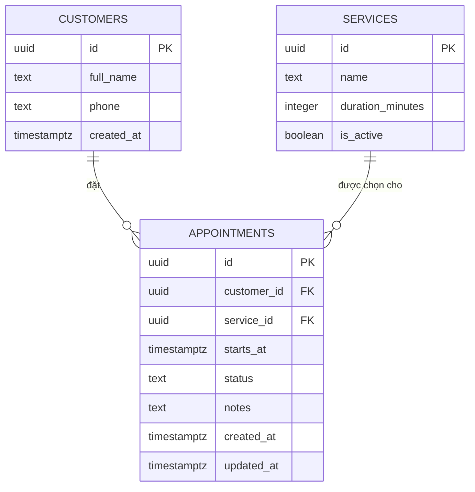
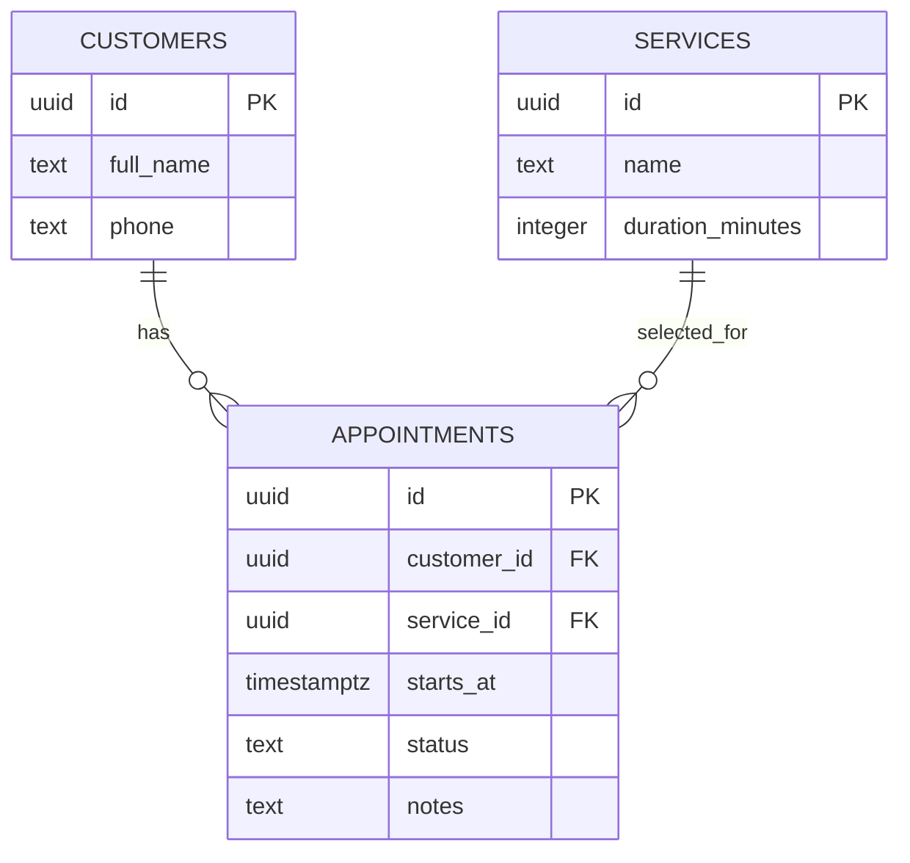

# Giáo án chi tiết - Buổi 4: Thiết kế kiến trúc dữ liệu với AI

**Thời lượng:** 180 phút  
**Đối tượng:** Người mới đã có product brief, user stories, wireframe và UI mock từ Buổi 1-3.  
**Sản phẩm cuối buổi:** Một **database design pack** cho MVP gồm: quyết định SQL/NoSQL và OLTP/OLAP có lý do, platform đã chọn, ERD, data dictionary, migration SQL và seed script chạy được trên Supabase/Postgres.

> Tên file giữ nguyên để không gãy liên kết cũ. Nội dung Buổi 4 đã đổi trọng tâm: **thiết kế dữ liệu trước, CRUD UI sau**. Buổi tiếp theo sẽ dùng design pack này để kết nối Supabase và làm CRUD thật.

## 1. Vị trí trong lộ trình

Vibe coding không phải giao việc “làm database” cho AI. Người học quyết định bài toán, dữ liệu, trade-off và tiêu chí đúng/sai; AI hỗ trợ phân tích, đề xuất, sinh ERD/script và review.

```text
Ý tưởng -> MVP/User Story -> UI mock
       -> Buổi 4: workload -> architecture -> ERD -> migration
       -> Buổi tiếp: kết nối database + CRUD UI thật
       -> Auth/RLS -> AI feature -> QA/Deploy
```

### Mục tiêu đầu ra có thể quan sát

Kết thúc buổi, học viên có thể:

1. Phân biệt workload vận hành với workload phân tích; chọn OLTP, OLAP hoặc kết hợp có lý do.
2. Chọn SQL/NoSQL dựa trên quan hệ dữ liệu, quy tắc đúng/sai và truy vấn, không theo xu hướng.
3. Chọn platform phù hợp MVP, nêu trade-off về tốc độ xây dựng, bảo mật, chi phí và mở rộng.
4. Chuyển 2-3 Must-have User Story thành entity, attribute, cardinality và ERD.
5. Thiết kế bảng/cột, PK, FK, constraints, timestamps, indexes chỉ phục vụ luồng MVP.
6. Dùng AI để tạo/review migration + seed SQL, chạy được trên project Supabase demo và kiểm tra trong Table Editor.

### Tiêu chí đạt

| Hạng mục | Điều kiện đạt |
|---|---|
| Decision record | Có workload, OLTP/OLAP, SQL/NoSQL, platform và trade-off ngắn |
| Scope | Tối đa 3 Must stories; entities chỉ phục vụ các story đó |
| ERD | Entities, PK, FK và quan hệ 1-1/1-n/n-n rõ ràng |
| Data dictionary | Mỗi cột có type, nullable/default, nguồn nhập và lý do tồn tại |
| Script | Có migration + seed data giả, chạy được trên Supabase/Postgres demo |
| Review | Có ít nhất 3 điểm phản biện AI/peer review và quyết định sửa cuối |
| An toàn | Không dữ liệu khách thật, không secret, không coi schema demo là bảo mật production |

## 2. Chuẩn bị

### Giảng viên

- Chuẩn bị artefact Buổi 2-3 và case xuyên suốt **Hana Desk**.
- Tạo Supabase project demo trống; mở sẵn SQL Editor, Table Editor và công cụ vẽ ERD (Mermaid/dbdiagram/Draw.io/FigJam).
- Chuẩn bị một ERD tốt, một migration lỗi và một migration chạy được.
- Chuẩn bị câu hỏi review: “Cột này phục vụ story nào?”, “Tại sao cần quan hệ này?”, “Query nào cần index?”, “Khi nào không cần tách bảng?”.

### Học viên

- Mang 2-3 Must-have User Story đã cắt scope.
- Có tài khoản Supabase và một UI mock từ Buổi 3 hoặc chọn case ở phần 8.
- Chỉ dùng tên, số điện thoại, email, doanh thu giả. Không đưa dữ liệu khách hàng, sức khỏe hay nội bộ thật vào tool/AI.

### Ranh giới buổi học

| Làm trong Buổi 4 | Để buổi sau / backlog |
|---|---|
| Workload, OLTP/OLAP, SQL/NoSQL, platform | CRUD UI, server actions/API |
| ERD, data dictionary, migration + seed script | Auth, RLS ownership, multi-tenant production |
| Kiểm tra table, FK, constraints, query SQL | Payment, replication, partitioning, warehouse thật |

## 3. Lý thuyết áp dụng

### 3.1 Bắt đầu từ workload

Trước khi chọn Supabase hay Firebase, trả lời ba câu:

1. Ai đang làm việc gì trên dữ liệu mỗi ngày?
2. Họ cần tạo/sửa từng record ngay lúc đó, hay tổng hợp lượng lớn dữ liệu để phân tích?
3. Dữ liệu có quan hệ và luật đúng/sai bắt buộc không?

| Workload | Ví dụ | Nhu cầu chính |
|---|---|---|
| Vận hành | Lễ tân tạo lịch, sales cập nhật lead, kho đổi trạng thái đơn | Ghi/đọc record chính xác, phản hồi nhanh |
| Phân tích | Chủ spa xem doanh thu 12 tháng theo dịch vụ | Aggregate dữ liệu lớn, dashboard, query đọc nặng |
| Kết hợp | Shop vừa xử lý đơn vừa báo cáo | Operational store trước; analytical layer khi thực sự cần |

### 3.2 OLTP và OLAP

| | OLTP | OLAP |
|---|---|---|
| Mục đích | Chạy nghiệp vụ hằng ngày | Phân tích/ra quyết định |
| Ví dụ | Tạo lịch, cập nhật order, ghi giao dịch | Doanh thu theo tháng, cohort khách hàng |
| Dữ liệu | Nhiều thay đổi nhỏ, thường xuyên | Lịch sử/tổng hợp, query đọc nặng |
| Thiết kế | Constraints, transactions, chuẩn hóa vừa đủ | Fact/dimension, aggregates |
| Platform ví dụ | PostgreSQL/Supabase, MySQL | BigQuery, Snowflake, Redshift |

**Quy tắc MVP:** app cần tạo/sửa record thì data store lõi thường là **OLTP**. Biểu đồ đơn giản có thể aggregate từ OLTP. Chỉ thêm warehouse/OLAP khi nhu cầu phân tích thật sự đòi hỏi.

### 3.3 SQL và NoSQL

| Tiêu chí | SQL phù hợp khi | NoSQL phù hợp khi |
|---|---|---|
| Quan hệ | Có quan hệ customer-order, appointment-service | Document/key độc lập, cấu trúc linh hoạt |
| Tính đúng | Cần FK, transaction, UNIQUE, CHECK | Chấp nhận schema mềm hơn theo use case |
| Truy vấn | Join, filter, reporting có cấu trúc | Truy cập document/key, schema thay đổi nhanh |
| Ví dụ | CRM, đặt lịch, order, thu chi | Event log, cache, feed/document chuyên biệt |

NoSQL không “hiện đại hơn”, SQL không “cũ hơn”. Nhiều hệ thống dùng cả hai, mỗi công cụ cho một nhu cầu cụ thể.

### 3.4 Chọn platform cho MVP

| Platform | Phù hợp nhất khi | Điểm mạnh | Trade-off |
|---|---|---|---|
| Supabase + Postgres | Web MVP có dữ liệu quan hệ | SQL, dashboard, Auth/RLS ở buổi sau | Phải thiết kế schema/RLS kỹ trước production |
| Firebase/Firestore | Prototype realtime/document-first | Setup nhanh, realtime | Quan hệ/query và chi phí cần thiết kế cẩn thận |
| Managed Postgres | Team có backend/deployment riêng | SQL chuẩn, hạ tầng linh hoạt | Tự vận hành nhiều phần hơn |
| BigQuery/Snowflake | BI và phân tích lớn | OLAP mạnh | Không thay database CRUD vận hành |

Mặc định lớp học chọn **Supabase/Postgres** cho CRM, đặt lịch, task, order và transaction: các case này thường cần SQL + OLTP. Đổi platform chỉ khi có lý do gắn với workload.

### 3.5 Từ user story đến ERD

Case **Hana Desk**: dashboard cho lễ tân spa.

| Must story | Entity/cột cần thiết | Quan hệ |
|---|---|---|
| Xem lịch hôm nay | appointment: thời gian, status, note | appointment thuộc customer và service |
| Tạo lịch từ cuộc gọi | customer: tên/SĐT demo; appointment: thời gian | customer có nhiều appointment |
| Đổi status lịch | appointment.status, updated_at | không cần entity mới |



Đọc ERD: “Một customer có thể có nhiều appointments; mỗi appointment thuộc đúng một customer.” Nếu một appointment có nhiều dịch vụ, không thêm `service_1`, `service_2`; chỉ tạo bảng nối khi có story đó.

### 3.6 Quy tắc thiết kế cột

| Quy tắc | Ví dụ đúng | Ví dụ chưa tốt |
|---|---|---|
| ID do hệ thống tạo | UUID primary key | Dùng tên khách làm key |
| Status bị giới hạn | `CHECK (status IN (...))` | Text tự do “gần xong” |
| Ngày giờ có timezone | `timestamptz` | Text “15/10 lúc 10h” |
| Có audit | `created_at`, `updated_at` | Không biết record đổi khi nào |
| Nullable có chủ đích | `notes` nullable | Mọi cột nullable |
| Index theo query thật | `(status, starts_at)` | Index mọi cột “cho nhanh” |

- **Constraint** bảo vệ sự đúng: `NOT NULL`, `UNIQUE`, `CHECK`, foreign key.
- **Index** tăng tốc query nhưng làm chậm ghi và tốn dung lượng; chỉ tạo khi có query cụ thể.
- **Migration** là lịch sử schema có version để review/chạy lại; không chỉ click trong dashboard.
- **Seed data** là dữ liệu giả có chủ đích để demo/test.

## 4. Kịch bản đứng lớp 180 phút

| Thời gian | Mục tiêu | Giảng viên | Học viên | Checkpoint |
|---|---|---|---|---|
| 00:00-00:15 | Đặt bài toán | So sánh tạo lịch với báo cáo doanh thu | Nêu một hành động vận hành và một câu hỏi phân tích | Không lẫn CRUD với analytics |
| 00:15-00:35 | OLTP/OLAP | Dạy qua Hana Desk/shop online | Phân loại 6 yêu cầu | Giải thích được vì sao |
| 00:35-00:55 | SQL/NoSQL | So sánh quan hệ, consistency, query | Chọn theo rubric | Có quyết định + trade-off |
| 00:55-01:15 | Platform | So sánh Supabase/Firestore/warehouse ở mức MVP | Viết decision record | Không chọn theo trend |
| 01:15-01:30 | Nghỉ + clinic | Cắt scope quá lớn | Hoàn thiện canvas | Tối đa 3 Must stories |
| 01:30-01:50 | Entity/relationship | Live story -> entity/cardinality | Liệt kê entities/cột | Có quan hệ rõ |
| 01:50-02:15 | ERD + dictionary | Demo cách cung cấp context và review ERD AI tạo | Đưa artefact Buổi 2 cho AI, kiểm tra/chỉnh ERD | ERD đọc được thành câu |
| 02:15-02:35 | Schema | Demo constraints/index từ query thật | Hoàn thành design | Mỗi cột/index có mục đích |
| 02:35-02:50 | AI + Supabase | Sinh/review SQL, chạy migration demo | Chạy migration + seed | Table Editor khớp ERD |
| 02:50-03:00 | Review | Điều phối peer review/pitch | Pitch 60 giây | Có plan sang buổi CRUD |

## 5. Canvas quyết định kiến trúc dữ liệu

```text
Tên sản phẩm / bài toán:
Người vận hành chính:
2-3 Must-have User Story:

Hành động ghi/sửa dữ liệu thường xuyên:
Câu hỏi báo cáo/phân tích:
=> Workload lõi: OLTP / OLAP / kết hợp. Lý do:

Quan hệ nào phải đúng? Ví dụ:
Schema có thay đổi tự do theo từng record? Ví dụ:
=> Chọn SQL / NoSQL. Lý do + trade-off:

Platform chọn:
Vì sao phục vụ MVP:
Không làm trong phiên bản 1:
```

### Bài mẫu - Hana Desk

```text
Workload lõi: OLTP. Lễ tân tạo, xem và đổi trạng thái từng lịch hẹn.
OLAP hiện tại: chưa cần warehouse; báo cáo ngày/tháng đơn giản aggregate từ Postgres.
Chọn SQL: appointment liên kết customer/service, cần FK và status hợp lệ.
Platform: Supabase/Postgres; thuận tiện migration demo, sau này có Auth/RLS.
Không làm: payment, ca làm, đa chi nhánh, Zalo, BI warehouse.
```

## 6. Lab: Hana Desk từ decision đến script

### A. Data dictionary

| Bảng.cột | Kiểu | Null/default | Nguồn | Lý do |
|---|---|---|---|---|
| `customers.id` | UUID | PK, tự tạo | hệ thống | định danh khách |
| `customers.full_name` | text | NOT NULL | lễ tân | tạo/xem lịch |
| `customers.phone` | text | NOT NULL, UNIQUE MVP | lễ tân/demo | nhận diện khách |
| `services.id` | UUID | PK | hệ thống | danh mục dịch vụ |
| `services.name` | text | NOT NULL, UNIQUE | admin demo | chọn dịch vụ |
| `services.duration_minutes` | integer | NOT NULL, CHECK > 0 | admin demo | thời lượng |
| `appointments.id` | UUID | PK | hệ thống | detail/edit/delete sau này |
| `appointments.customer_id` | UUID | NOT NULL, FK | form | khách của lịch |
| `appointments.service_id` | UUID | NOT NULL, FK | form | dịch vụ chọn |
| `appointments.starts_at` | timestamptz | NOT NULL | form | lịch hôm nay/sort |
| `appointments.status` | text | default + CHECK | form/action | filter/xử lý |
| `appointments.notes` | text | NULL | form | bổ sung |

Trade-off: Buổi 3 có thể dùng `service_name` text trong mock. Tách bảng `services` chỉ hợp lý khi danh mục dịch vụ được dùng lại; nếu chưa có story này, không cần tách.

### B. ERD review

Trước SQL, từng cặp trả lời:

1. Có tạo appointment mà thiếu customer/service không? Nếu không, FK phải `NOT NULL`.
2. Nếu xóa customer đang có appointment thì sao? MVP chặn bằng `RESTRICT` để không mất lịch sử ngầm.
3. Status được phép có giá trị nào, ai thay đổi nó?
4. Query list phổ biến là gì? Ví dụ lịch theo status, sắp theo thời gian.

### C. Migration SQL

Trong Supabase SQL Editor, tạo migration như `001_create_hana_desk_schema.sql`. Đọc từng khối trước khi chạy.

```sql
create table public.customers (
  id uuid primary key default gen_random_uuid(),
  full_name text not null check (char_length(trim(full_name)) between 2 and 100),
  phone text not null unique check (char_length(trim(phone)) between 8 and 30),
  created_at timestamptz not null default now(),
  updated_at timestamptz not null default now()
);

create table public.services (
  id uuid primary key default gen_random_uuid(),
  name text not null unique check (char_length(trim(name)) between 2 and 100),
  duration_minutes integer not null check (duration_minutes > 0 and duration_minutes <= 480),
  is_active boolean not null default true,
  created_at timestamptz not null default now(),
  updated_at timestamptz not null default now()
);

create table public.appointments (
  id uuid primary key default gen_random_uuid(),
  customer_id uuid not null references public.customers(id) on delete restrict,
  service_id uuid not null references public.services(id) on delete restrict,
  starts_at timestamptz not null,
  status text not null default 'pending'
    check (status in ('pending', 'confirmed', 'completed', 'cancelled')),
  notes text,
  created_at timestamptz not null default now(),
  updated_at timestamptz not null default now()
);

create index appointments_starts_at_idx on public.appointments (starts_at);
create index appointments_status_starts_at_idx on public.appointments (status, starts_at);

create or replace function public.set_updated_at()
returns trigger language plpgsql as $$
begin
  new.updated_at = now();
  return new;
end;
$$;

create trigger customers_set_updated_at before update on public.customers
for each row execute function public.set_updated_at();
create trigger services_set_updated_at before update on public.services
for each row execute function public.set_updated_at();
create trigger appointments_set_updated_at before update on public.appointments
for each row execute function public.set_updated_at();
```

Kiểm tra: Table Editor có ba bảng; PK/FK đúng; thử insert status sai để thấy `CHECK` chặn; update một record để thấy `updated_at` thay đổi.

### D. Seed và query đại diện cho UI

```sql
insert into public.customers (full_name, phone)
values ('Nguyễn Minh - demo', '0900000001'), ('Trần An - demo', '0900000002');

insert into public.services (name, duration_minutes)
values ('Chăm sóc da cơ bản', 60), ('Massage thư giãn', 90);

insert into public.appointments (customer_id, service_id, starts_at, status, notes)
select c.id, s.id, '2026-10-15 03:00:00+00', 'pending', 'Dữ liệu minh họa'
from public.customers c cross join public.services s
where c.phone = '0900000001' and s.name = 'Chăm sóc da cơ bản';

select a.id, c.full_name, s.name as service_name, a.starts_at, a.status
from public.appointments a
join public.customers c on c.id = a.customer_id
join public.services s on s.id = a.service_id
where a.status in ('pending', 'confirmed')
order by a.starts_at asc;
```

Seed phải chạy sau tables, tôn trọng FK và luôn là dữ liệu giả.

## 7. Prompt AI theo lát cắt

### Prompt 1 - Workload và platform

> Bạn là data architect cho MVP. Bài toán: [MÔ TẢ]. Người dùng: [AI]. Must stories: [DÁN 2-3 STORY]. Hành động vận hành: [DANH SÁCH]. Câu hỏi báo cáo: [DANH SÁCH]. Hãy (1) phân loại OLTP/OLAP, (2) đề xuất SQL hoặc NoSQL cho data store lõi, (3) so sánh tối đa hai platform, (4) chốt một phương án cùng trade-off và phần chưa nên xây. Không tự thêm Auth, payment, warehouse hay microservice.

### Prompt 2 - ERD và dictionary

> Bạn là database designer. Dựa trên MVP sau: [DÁN], hãy tạo ERD tối giản bằng Mermaid `erDiagram`, rồi lập data dictionary: table, column, PostgreSQL type, nullable/default, PK/FK/constraint và User Story sử dụng cột đó. Giải thích các quan hệ 1-1, 1-n hoặc n-n. Chỉ thiết kế phần phục vụ MVP; liệt kê phần để sau.

### Prompt 3 - Migration có kiểm soát

> Dựa trên ERD/data dictionary đã duyệt, tạo một migration PostgreSQL cho Supabase: UUID PK, FK với delete behavior có lý do, timestamps, CHECK/UNIQUE, trigger `updated_at` và tối đa hai index dựa trên query [DÁN QUERY]. Không có RLS, Auth, service-role key hay dữ liệu thật. Trước SQL, nêu assumptions và rủi ro cần xác nhận.

### Prompt 4 - Review script

> Review migration PostgreSQL sau theo thứ tự: khớp Must stories/ERD; PK/FK/delete behavior; nullable/default; constraint; index dựa trên query; khả năng chạy migration; timestamps; dữ liệu nhạy cảm/Auth scope. Trả về issue P0/P1/P2, thay đổi nhỏ nhất và một test SQL cho từng issue. Không viết lại toàn bộ nếu không cần.

## 8. Bài toán thực tế

| Case | Workload lõi | Hướng chọn | ERD tối thiểu | Câu hỏi phản biện |
|---|---|---|---|---|
| Hana Desk | Tạo/cập nhật lịch | SQL + OLTP + Supabase | customer 1-n appointment; service 1-n appointment | Khi nào cần staff/room chống trùng giờ? |
| CRM agency | Lead/follow-up | SQL + OLTP + Supabase | company 1-n lead; lead 1-n interaction | Có unique email không? |
| Đội thi công | Task/deadline/status | SQL + OLTP + Supabase | project 1-n task | Có cần status history ngay không? |
| Shop online | Đơn hàng/line item | SQL + OLTP; OLAP sau | customer 1-n order; order 1-n order_item | Vì sao order total không chỉ tính giá hiện tại? |
| Feed sự kiện | Activity/event nhiều | NoSQL/event store tùy query; OLAP cho analytics | event: actor, type, payload | Document hay quan hệ/reporting? |
| Báo cáo đa năm | Aggregate đọc lớn | OLAP warehouse | fact_transaction + dimensions khi cần | Warehouse có giải quyết CRUD không? |

### Bài 1 - Chọn sai công cụ

**Đề:** Nhóm dùng BigQuery làm database chính cho app lễ tân vì “query nhanh”, chọn Firestore vì “realtime”.

**Yêu cầu:** Nêu hai lý do chưa hợp MVP và chốt lựa chọn khác.

**Đáp án gợi ý:** Lễ tân làm OLTP tạo/sửa record; BigQuery là OLAP và không thay CRUD store. Firestore có thể dùng realtime nhưng quan hệ customer-service-appointment, constraints và reporting khiến Postgres/Supabase là mặc định dễ kiểm soát hơn. Đây là trade-off, không phải Firestore “xấu”.

### Bài 2 - ERD triage

**Đề:** App spa chỉ có xem lịch, tạo lịch, đổi status nhưng nhóm vẽ 10 bảng: customers, appointments, services, employees, shifts, rooms, payments, coupons, reviews, message_logs.

**Yêu cầu:** Chọn tối đa ba bảng cho MVP và giải thích bằng Must story.

**Đáp án gợi ý:** Giữ `customers`, `services`, `appointments` nếu danh mục dịch vụ dùng lại; nếu không, `appointments` + `service_name` text cũng đủ. Phần còn lại là backlog.

### Bài 3 - Constraint

**Đề:** Status là `maybe`, duration là `-30`, appointment trỏ tới customer đã xóa.

**Yêu cầu:** Đề xuất constraint và test SQL cho từng lỗi.

**Điểm cần có:** `CHECK status IN (...)`, `CHECK duration_minutes > 0`, FK với `ON DELETE RESTRICT` hoặc quyết định lịch sử khác có chủ đích. Không chỉ ẩn option ở UI.

### Bài 4 - Index reasoning

**Đề:** Màn hình chính query lịch chưa hoàn thành hôm nay, sắp theo giờ.

**Yêu cầu:** Viết query minh họa, đề xuất index và giải thích tại sao không index `notes`.

**Hướng đáp án:** Query dùng `status` + `starts_at`, nên composite index `(status, starts_at)` có lý do. Index có chi phí storage/ghi; notes không phục vụ query này.

## 9. Checklist review

### Product và architecture

- [ ] Nêu được workload vận hành và phân tích.
- [ ] Chọn OLTP/OLAP, SQL/NoSQL bằng tiêu chí cụ thể.
- [ ] Platform phù hợp MVP, phần không làm được ghi rõ.
- [ ] Mỗi table/cột truy ngược về Must story hoặc yêu cầu hệ thống chính đáng.

### ERD và schema

- [ ] PK ổn định, quan hệ có FK hoặc lý do không dùng.
- [ ] Cardinality đọc được thành câu; không dùng field lặp cho quan hệ n-n.
- [ ] Cột quan trọng có type, default/nullable, constraint và timestamps.
- [ ] Delete behavior có chủ đích; index gắn với query thực.

### Script/an toàn

- [ ] Migration chạy thành công trên project demo trống.
- [ ] Seed data giả, chạy sau table và tôn trọng FK.
- [ ] Đã thử ít nhất một input sai để chứng minh constraint.
- [ ] Không có API/service-role key hay data khách thật.
- [ ] Ghi rõ Auth/RLS ownership là bước tiếp theo trước production.

## 10. Rubric cuối buổi

| Tiêu chí | Đạt | Cần làm tiếp |
|---|---|---|
| Lý do kiến trúc | Chọn đúng theo workload và trade-off | Chọn theo trend/AI nói |
| ERD | Tối giản, PK/FK/cardinality rõ | Entity dư, quan hệ mơ hồ |
| Schema | Type/constraint/index gắn story/query | Tất cả text/nullable, không luật data |
| Script | Migration + seed chạy được | Chưa chạy hoặc chứa dữ liệu/secret nhạy cảm |
| Phản biện | Có review và quyết định sửa | Nhận nguyên đầu ra AI |
| Scope/an toàn | Nêu rõ hạn chế Auth/RLS | Nhầm schema là production security |

## 11. Bài tập liên thông: tiếp tục dự án từ Buổi 2

### Mục đích

Học viên **không chọn một case mới**. Họ dùng đúng product brief, 5-8 User Story, page map và wireframe đã làm ở Buổi 2 để thiết kế dữ liệu cho sản phẩm của mình. Bài tập biến các artefact sản phẩm đã có thành đầu vào kỹ thuật, tạo đường nối rõ ràng từ:

```text
Buổi 2: User Story -> page map -> wireframe
Buổi 4: user action trên wireframe -> data cần lưu -> ERD -> migration
Buổi 5: route/form từ Buổi 2 -> query/mutation CRUD
```

### Đầu vào bắt buộc mang từ Buổi 2

| Artefact Buổi 2 | Dùng trong bài tập Buổi 4 như thế nào |
|---|---|
| Product brief | Xác định người vận hành, giá trị sản phẩm và scope MVP |
| 2-3 Must-have User Story | Quyết định entity, cột và thao tác dữ liệu bắt buộc |
| Page map/routes | Xác định page nào cần list/detail/create/edit và query tương ứng |
| Wireframe | Chỉ ra field người dùng nhập, dữ liệu hiển thị, filter và CTA |
| Danh sách “Later” | Chủ động loại table/cột/tính năng chưa phục vụ MVP |

### Đề bài

> Dùng dự án từ Buổi 2. Chọn **một thực thể chính** đã xuất hiện trong Must stories. Từ user story, page map và wireframe sẵn có, hãy thiết kế database cho MVP theo quy trình dưới đây. Không thêm tính năng mới chỉ để có nhiều bảng.

#### Bước 1 - Traceability canvas (15 phút)

Điền bảng này bằng chính nội dung Buổi 2:

| Must story Buổi 2 | Route/wireframe liên quan | Người dùng bấm/nhập gì? | Dữ liệu phải lưu lâu dài | Không cần lưu ở MVP |
|---|---|---|---|---|
| | | | | |
| | | | | |
| | | | | |

**Quy tắc phân biệt:**

- Nội dung chỉ để hiển thị cố định (headline, nhãn nút) không nhất thiết là cột database.
- State giao diện tạm thời (modal đang mở, input đang gõ dở) không nhất thiết phải lưu.
- Hành động cần còn đúng sau refresh hoặc cần dùng ở page khác phải có dữ liệu lưu bền vững.

#### Bước 2 - Quyết định kiến trúc (10 phút)

Từ canvas, hoàn thành decision record:

```text
Workload vận hành chính của dự án Buổi 2:
Câu hỏi phân tích/báo cáo (nếu có):
Chọn OLTP / OLAP / kết hợp và lý do:
Chọn SQL / NoSQL và lý do:
Platform chọn cho MVP và trade-off:
Một phần trong wireframe sẽ làm ở Buổi 5:
Ba phần Later không thiết kế hôm nay:
```

#### Bước 3 - ERD và dictionary (25 phút)

1. Chuẩn bị input cho AI: Must stories, traceability canvas, page map, wireframe và phần Later.
2. Dùng Prompt 2 ở phần 7 để AI tạo ERD có PK, FK, cardinality, delete behavior và data dictionary nháp.
3. Học viên kiểm tra/correct ERD bằng câu hỏi nghiệp vụ: “quan hệ này có đúng cách sản phẩm vận hành không?”, “bảng/cột nào chưa phục vụ story?”, “dữ liệu nào thiếu để UI hoạt động?”.
4. Yêu cầu AI chỉnh ERD **theo phản hồi cụ thể**, sau đó chốt ERD và data dictionary.
5. Viết tối đa ba query dự kiến từ page map: list, detail và filter/sort; dùng chúng để đề xuất tối đa hai index có lý do.

#### Bước 4 - Migration, seed và review (25 phút)

1. Dùng Prompt 3 ở phần 7 để tạo migration PostgreSQL/Supabase.
2. So với ERD/data dictionary; sửa tên cột, type, constraint hoặc index không khớp trước khi chạy.
3. Tạo seed data giả tối thiểu: 3 records có trạng thái khác nhau, một edge case để test.
4. Chạy migration vào project demo trống, kiểm tra Table Editor, rồi chạy ba query dự kiến.
5. Đổi bài cho một nhóm khác review bằng Prompt 4; ghi lại ít nhất một quyết định đã thay đổi.

### Ví dụ nối tiếp hoàn chỉnh: Hana Desk

| Artefact Buổi 2 | Quyết định Buổi 4 |
|---|---|
| Story: lễ tân xem lịch hôm nay | `appointments.starts_at`, `status`; query list theo ngày/giờ |
| Story: tạo lịch từ cuộc gọi | `customers` + `appointments`; form cần customer, service, thời gian |
| Story: đổi trạng thái | `appointments.status`, `updated_at`; CHECK cho bốn status |
| Wireframe list có filter status | composite index `(status, starts_at)` |
| Later: SMS, payment, lịch nhân viên | Không có bảng `message_logs`, `payments`, `staff_shifts` ở MVP |

### Cách hoàn thành bài tập - làm theo từng bước

Phần này là hướng dẫn thao tác dành cho học viên. Mỗi bước phải tạo ra một artefact lưu được; không chuyển sang bước sau nếu đầu ra bước trước còn mơ hồ.

#### Bước A - Mở lại đúng artefact Buổi 2 (5 phút)

1. Mở product brief, bảng Must/Should/Later, page map và wireframe của dự án mình.
2. Khoanh **ba** Must story. Nếu có hơn ba, giữ ba story tạo ra một luồng vận hành khép kín.
3. Chọn một thực thể chính xuất hiện lặp lại trong các story: `appointment`, `lead`, `task`, `order` hoặc `transaction`.
4. Tạo folder nộp bài và tạo tám file theo danh sách deliverable ở phần dưới.

**Ví dụ Hana Desk:** chọn `appointment`, không chọn đồng thời customer, nhân viên, ca làm, khuyến mãi và thanh toán là các thực thể chính. `customer` và `service` chỉ là entity phụ vì lịch hẹn cần tham chiếu đến chúng.

#### Bước B - Điền traceability trước, không hỏi AI ngay (10 phút)

Đọc từng story và wireframe, sau đó tự điền bảng. Một cột chỉ được thêm khi có ô “dữ liệu phải lưu lâu dài” tương ứng.

| Must story | Route/wireframe | Người dùng bấm/nhập | Dữ liệu lưu lâu dài | Không lưu ở MVP |
|---|---|---|---|---|
| Xem lịch hôm nay | `/appointments`, list/filter | Chọn ngày, status | giờ hẹn, status, khách, dịch vụ | modal filter đang mở |
| Tạo lịch từ cuộc gọi | `/appointments/new`, form | chọn/nhập khách, dịch vụ, giờ, note | customer, service, `starts_at`, note | trạng thái focus của input |
| Đổi status lịch | `/appointments/[id]`, detail | chọn confirmed/cancelled | status, `updated_at` | toast “đã lưu” |

**Tự kiểm tra:** Nếu reload trang, dữ liệu đó có cần còn không? Nếu câu trả lời là có, nó là ứng viên database. Nếu chỉ tồn tại trong lúc người dùng đang thao tác UI, nó không phải cột database.

#### Bước C - Viết decision record (10 phút)

Sao chép mẫu dưới đây vào `02-architecture-decision.md`, thay nội dung trong ngoặc vuông. Viết bằng lời của mình trước; chỉ sau đó mới dùng Prompt 1 để nhờ AI phản biện.

```md
# Architecture decision - [Tên dự án]

## Workload
- Vận hành: [ai] cần [tạo/xem/sửa gì] với tần suất [mô tả].
- Phân tích: [câu hỏi báo cáo], hoặc “chưa có trong MVP”.

## Quyết định
- Chọn: [OLTP / OLAP / kết hợp].
- Lý do: [1-2 câu gắn với workload].
- Chọn data model: [SQL / NoSQL].
- Lý do: [quan hệ, quy tắc dữ liệu và query].
- Platform: [Supabase/Postgres hoặc lựa chọn khác].

## Trade-off và scope
- Lợi ích cho MVP: [...]
- Chưa làm: [...]
- Rủi ro trước production: [Auth/RLS, dữ liệu nhạy cảm, ...]
```

**Đáp án mẫu Hana Desk:** Chọn OLTP + SQL + Supabase/Postgres vì lễ tân liên tục ghi/sửa từng lịch, appointment có quan hệ với customer/service, và status cần luật hợp lệ. Báo cáo doanh thu dài hạn, thanh toán và nhiều chi nhánh chưa thuộc MVP.

#### Bước D - Nhờ AI tạo ERD từ mô tả sản phẩm (15 phút)

Học viên **không cần tự vẽ ERD từ đầu**. Học viên có trách nhiệm chuẩn bị đúng đầu vào và đánh giá đầu ra; AI có trách nhiệm biểu diễn mô hình đó thành ERD.

1. Gom vào một prompt: 2-3 Must stories, traceability canvas đã điền, page map, các field nhìn thấy trên wireframe và danh sách Later.
2. Dùng Prompt 2 ở phần 7 để yêu cầu AI tạo ERD Mermaid + data dictionary nháp. Yêu cầu AI không thêm entity/tính năng ngoài input.
3. Đọc ERD AI trả về bằng ngôn ngữ nghiệp vụ: “một customer có thể có nhiều appointments” có đúng không? “một appointment có đúng một service” có đúng không?
4. Đối chiếu ERD với wireframe: mọi field người dùng nhập hoặc cần hiển thị có đường đi dữ liệu không? AI có thêm bảng/cột Later không?
5. Nếu có sai lệch, gửi feedback cụ thể để AI sửa ERD, rồi lưu bản đã duyệt vào `03-erd.md`.

Prompt điền sẵn cho Hana Desk:

> Bạn là database designer. Dựa trên ba Must stories sau: (1) lễ tân xem lịch hôm nay theo status, (2) lễ tân tạo lịch từ cuộc gọi bằng tên khách, số điện thoại demo, dịch vụ, ngày giờ và ghi chú, (3) lễ tân đổi status lịch; cùng page map có list, detail và create/edit form, hãy tạo ERD Mermaid tối giản và data dictionary PostgreSQL. Chỉ dùng `customers`, `services`, `appointments` nếu thật sự cần. Không thêm payment, nhân viên, ca làm, SMS, review hay Auth. Với mỗi cột, nêu story/wireframe sử dụng nó.

ERD mong đợi sau khi AI đã nhận feedback có thể là:



**Điểm dừng để phản hồi AI:** ERD tạo ra quan hệ không khớp vận hành thật, thêm entity thuộc Later, dùng field lặp như `service_1`, `service_2`, hoặc thiếu dữ liệu mà wireframe cần hiển thị.

#### Bước E - Viết data dictionary và query plan (15 phút)

Trong `04-data-dictionary.md`, viết một dòng cho mỗi cột. Không để cột chỉ có tên mà không có lý do.

| Table.column | Type | Null/default | Nhập từ wireframe nào? | Story/query sử dụng |
|---|---|---|---|---|
| `appointments.id` | uuid | PK/default | hệ thống | mở detail, update/delete sau này |
| `appointments.customer_id` | uuid | NOT NULL, FK | form tạo | tạo/list lịch của khách |
| `appointments.starts_at` | timestamptz | NOT NULL | form tạo | lịch hôm nay, sort |
| `appointments.status` | text | `pending` + CHECK | form/detail | filter và đổi status |
| `appointments.notes` | text | NULL | form tạo | detail |

Trong `07-query-plan.md`, viết ba query bằng tiếng Việt trước, rồi mới SQL:

1. List: “Lễ tân xem lịch `pending` hoặc `confirmed`, sắp theo `starts_at` tăng dần.”
2. Detail: “Lễ tân mở một appointment theo `id`, kèm customer và service.”
3. Filter: “Lễ tân lọc lịch theo status và ngày.”

Từ đây giải thích index: index `(status, starts_at)` phục vụ list/filter đầu tiên; không index `notes` nếu không có query nào tìm theo notes.

#### Bước F - Tạo script, chạy và chứng minh đúng (20 phút)

1. Dán ERD, dictionary và ba query vào Prompt 3 ở phần 7; yêu cầu AI chỉ đề xuất migration.
2. Đọc đầu ra theo checklist: table/cột có trong dictionary không, FK có đúng entity không, constraint có bảo vệ rule không, index có query thật không?
3. Lưu SQL đã sửa vào `05-migration.sql`; tạo dữ liệu giả trong `06-seed.sql`.
4. Trên Supabase project demo trống, chạy migration trước, seed sau.
5. Mở Table Editor: xác nhận bảng/cột/quan hệ hiện đúng. Chạy ba query từ query plan.
6. Thử một dữ liệu sai, ví dụ `status = 'maybe'` hoặc `duration_minutes = -30`; ghi ảnh/lỗi nhận được vào `08-review-notes.md`.

**Nếu script lỗi:** không xóa database hoặc chạy lại nhiều lần. Đọc dòng lỗi, đối chiếu ERD/dictionary, sửa statement nhỏ nhất, ghi nguyên nhân và cách sửa vào review notes.

#### Bước G - Review chéo và chốt sang Buổi 5 (10 phút)

Đổi folder bài với một bạn. Reviewer chỉ trả lời năm câu:

1. Mọi table/cột có truy ngược được về Must story/wireframe không?
2. Có entity nào thuộc “Later” nhưng lẫn vào schema không?
3. FK, delete behavior và status constraint có phù hợp không?
4. Ba query có chạy được với schema này không; index nào thật sự cần?
5. Route/form nào ở Buổi 5 sẽ dùng Create, Read, Update, Delete?

Tác giả chọn ít nhất một góp ý để sửa và ghi theo mẫu:

```text
Vấn đề nhận được:
Quyết định trước review:
Thay đổi đã thực hiện:
Lý do giữ hoặc sửa:
Cách kiểm tra lại:
```

### Deliverable nộp cuối buổi

Mỗi học viên/nhóm nộp một thư mục hoặc document có cấu trúc:

```text
01-traceability.md       # Story -> page/wireframe -> data
02-architecture-decision.md
03-erd.(md/png/link)
04-data-dictionary.md
05-migration.sql
06-seed.sql
07-query-plan.md         # list/detail/filter + index rationale
08-review-notes.md       # góp ý nhận được và thay đổi đã chốt
```

### Rubric riêng cho bài liên thông

| Tiêu chí | Đạt khi |
|---|---|
| Kết nối Buổi 2 | Tất cả table/cột/query đều truy ngược được về story, route hoặc wireframe có sẵn |
| Cắt scope | Các mục Later không len vào schema MVP |
| Độ đúng model | ERD, data dictionary, migration và query không mâu thuẫn nhau |
| Khả năng triển khai | Mỗi UI page có hướng Read/Create/Update rõ để Buổi 5 tiếp tục |
| Phản biện | Có review và ít nhất một thay đổi có lý do |

## 12. Bài tập giữa Buổi 4 và buổi CRUD

1. Hoàn thiện design pack: decision record, ERD, data dictionary, migration, seed SQL và ba query đại diện UI.
2. Dùng AI review script, sửa ít nhất một góp ý; ghi “trước/sau/lý do”.
3. Chạy migration từ database demo trống, chụp Table Editor và test một constraint sai.
4. Viết plan cho buổi CRUD: routes đọc list, form tạo/sửa, loading/empty/error và delete confirm.

### Mẫu nộp bài

```text
Tên dự án:
Must stories:
Workload lõi và lý do:
SQL/NoSQL + platform + trade-off:
Link/ảnh ERD:
Tables + quan hệ:
Link migration + seed:
Ba query đại diện UI:
Constraint đã test:
Việc chuyển sang buổi CRUD:
Rủi ro cần giải quyết trước production/Auth:
```

## 13. Thông điệp chốt buổi

Thiết kế database tốt trong vibe coding không phải tạo nhiều bảng nhất, cũng không phải để AI vẽ ERD trông chuyên nghiệp. Đó là chọn đúng loại hệ thống cho workload, lưu đúng dữ liệu cho luồng người dùng, đặt luật để dữ liệu không sai, và tạo script người khác có thể review/chạy lại. Khi design đã vững, Buổi CRUD sau đó sẽ nhanh hơn và ít phải sửa ngược.
